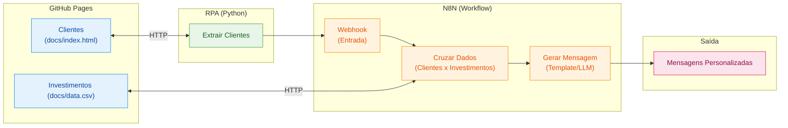

# Criando um Assistente de Investimentos com RPA e IA Generativa

## Descrição

Aprenda na prática como criar um fluxo de automação inteligente combinando técnicas de RPA (Robotic Process Automation) com workflows de IA no N8N.

Neste desafio, você vai construir um assistente de investimentos automatizado. O fluxo começa com a extração de dados de clientes em uma página web usando Python, passa pela orquestração de um workflow no N8N e termina com a geração de mensagens personalizadas para cada perfil de investidor.

O projeto foi pensado para ser simples e acessível, mesmo para quem está dando os primeiros passos em Python e automação. A ideia é que você entenda o conceito de RPA de forma leve e aplique tudo em um cenário realista do mercado financeiro.

## Objetivo do Projeto

Desenvolver um pipeline de automação que:

1. **Coleta dados de clientes** de uma página web simulada usando Python
2. **Processa as informações** através de um workflow no N8N
3. **Cruza perfis de investidor** com uma base de opções de investimento
4. **Gera mensagens personalizadas** para cada cliente

Ao final, você terá um sistema funcional que demonstra como empresas do setor financeiro podem automatizar a comunicação com clientes de forma inteligente.

## Arquitetura do Projeto



## Tecnologias e Ferramentas

O projeto utiliza ferramentas gratuitas e acessíveis, organizadas conforme cada etapa do fluxo:

| Etapa | Ferramenta | Função |
|-------|-----------|--------|
| Hospedagem | GitHub Pages | Servir a página de clientes e o CSV de investimentos |
| Extração (RPA) | Python + BeautifulSoup | Coletar dados dos clientes via web scraping |
| Orquestração | N8N | Processar dados, cruzar perfis e gerar mensagens |
| Geração com IA | Agente de IA no N8N | Criar mensagens personalizadas com LLM (desafio extra) |

Além dessas, você pode usar IAs generativas como **Gemini**, **Claude** ou **ChatGPT** como copilotos para auxiliar na escrita de código e tirar dúvidas ao longo do desenvolvimento.

## Roteiro do Desafio

### Etapa 1: Entenda o Projeto

Antes de começar, explore o repositório base que já contém a estrutura inicial:

1. **Página de Clientes (`docs/index.html`):** Uma página HTML hospedada no GitHub Pages com uma lista de clientes fictícios contendo nome, email, saldo e perfil de investidor (Conservador, Moderado ou Arrojado). Disponível online [neste link](https://digitalinnovationone.github.io/dio-lab-assistente-investimentos-rpa-n8n).
2. **Dados de Investimentos (`docs/data.csv`):** Um arquivo CSV também hospedado no GitHub Pages com opções de investimento organizadas por perfil. Disponível online [neste link](https://digitalinnovationone.github.io/dio-lab-assistente-investimentos-rpa-n8n/data.csv).
3. **Script de RPA (`src/extrair_clientes.ipynb`):** Um notebook Python que acessa a página de clientes e extrai os dados da tabela usando BeautifulSoup.

> 🤖 **Por que o script é considerado RPA?** Ele faz exatamente o que um humano faria manualmente: abre uma página, lê os dados de uma tabela e os envia para outro sistema. A diferença é que o "robô" (código) executa isso automaticamente. Essa abordagem é útil quando não existe uma API disponível ou quando precisamos integrar sistemas legados.

### Etapa 2: Configure o Ambiente

1. Faça um **fork** do repositório base para sua conta do GitHub
2. Crie uma conta no [N8N Cloud](https://n8n.io/) ou instale localmente
3. Abra o notebook `src/extrair_clientes.ipynb` no [Google Colab](https://colab.research.google.com/) e execute para entender o fluxo de extração

> 💡 **Atenção:** O script já extrai os dados, mas o envio ao N8N está comentado (`TODO`). Você vai configurar a URL do Webhook após criá-lo na próxima etapa.

### Etapa 3: Desenvolva o Workflow no N8N

Este é o coração do desafio! Monte um fluxo que:

1. Receba os dados dos clientes via Webhook (copie a URL gerada e configure no script Python)
2. Leia o arquivo `docs/data.csv` com as opções de investimento
3. Cruze o perfil de cada cliente com a opção adequada
4. Gere uma mensagem de recomendação para cada cliente

### Etapa 4 (MVP): Mensagens Estáticas

Para a versão mínima, use templates de mensagem fixos baseados no perfil:

- **Conservador:** Foco em renda fixa e segurança
- **Moderado:** Mix equilibrado entre renda fixa e variável
- **Arrojado:** Ênfase em ações e maior potencial de retorno

### Etapa 5 (Desafio): Integração com IA Generativa

Conecte o Agente de IA do N8N a um modelo como Gemini ou GPT para:

- Analisar o contexto do cliente (saldo, perfil)
- Gerar mensagens únicas e personalizadas
- Criar recomendações mais inteligentes e humanizadas

## Entregáveis

### MVP (Mínimo Viável)

- [ ] Repositório forkado com o workflow N8N implementado
- [ ] Workflow N8N exportado (`n8n/workflow.json`) com mensagens estáticas
- [ ] Script de RPA integrado ao Webhook do N8N
- [ ] Print ou vídeo demonstrando o fluxo funcionando de ponta a ponta

### Desafio Completo

- [ ] Todos os itens do MVP
- [ ] Integração com Agente de IA no N8N
- [ ] Mensagens geradas dinamicamente via LLM
- [ ] Documentação explicando as decisões técnicas

## Estrutura do Repositório

```
📁 dio-lab-assistente-investimentos-rpa-n8n/
├── 📄 README.md
├── 📁 src/
│   └── 📄 extrair_clientes.ipynb   # ✅ Notebook Python (já implementado, falta só o TODO)
├── 📁 n8n/
│   └── 📄 workflow.json            # 🎯 Seu desafio: exportar o workflow aqui
└── 📁 docs/
    ├── 📄 index.html               # ✅ Página de clientes (já implementado)
    └── 📄 data.csv                 # ✅ Opções de investimento (já implementado)
```

## Prompts Úteis para Copilotos de IA

| Tarefa | Sugestão de Prompt |
|--------|-------------------|
| Gerar dados fictícios | "Crie 10 clientes fictícios com nome, email, saldo e perfil de investidor em JSON" |
| Entender código | "Explique o que faz a biblioteca BeautifulSoup em Python" |
| Debugar erros | "Meu script Python está dando erro X, o que pode ser?" |
| Montar workflow | "Como configuro um webhook no N8N para receber dados JSON?" |

## Referências

- [Documentação do N8N](https://docs.n8n.io/)
- [BeautifulSoup: Web Scraping com Python](https://realpython.com/beautiful-soup-web-scraper-python/)
- [GitHub Pages: Guia Rápido](https://pages.github.com/)

---

**Bons estudos e mãos à obra** 🚀

Se tiver dúvidas, lembre-se: a melhor forma de aprender é experimentando. Erre, corrija e celebre cada pequena vitória no caminho.


---

---

## Implementação realizada

### 1. Visão geral

Foi implementada a versão MVP (Mínimo Viável) do Assistente de Investimentos, utilizando Python, n8n, GitHub Pages, ngrok e Google Sheets.

A automação coleta os dados de clientes fictícios publicados em uma página web, envia essas informações ao n8n por meio de um Webhook, cruza o perfil de cada cliente com um catálogo de investimentos e gera mensagens estáticas de recomendação.

Ao final, os resultados são registrados no Google Sheets, com uma linha por cliente e três opções de investimento por perfil.

### 2. Arquitetura implementada

O fluxo utiliza duas fontes de dados:

- **Clientes:** extraídos da página HTML publicada no GitHub Pages, utilizando Python, `requests` e BeautifulSoup no Google Colab.
- **Catálogo de investimentos:** arquivo CSV publicado no GitHub Pages e carregado pelo n8n por meio de uma requisição HTTP.

O envio dos clientes ao n8n é realizado por uma requisição HTTP POST. Como o n8n está instalado localmente, foi utilizado o ngrok para disponibilizar temporariamente um endereço HTTPS que encaminha as requisições ao ambiente local.

O workflow executa as seguintes etapas:

1. Recebe os dados dos clientes pelo Webhook.
2. Separa os clientes individualmente.
3. Organiza os campos de nome, e-mail, saldo e perfil.
4. Baixa o catálogo de investimentos em CSV.
5. Extrai os registros do catálogo.
6. Combina clientes e produtos utilizando o campo `perfil`, mantendo apenas as correspondências.
7. Prepara os dados das recomendações.
8. Gera uma mensagem estática para cada combinação de cliente e produto.
9. Agrupa as três recomendações de cada cliente em um único registro.
10. Grava os resultados no Google Sheets.

### 3. Principais decisões técnicas

**Integração por Webhook**

O Webhook recebe os dados em formato JSON. O Python envia a lista de clientes em uma requisição POST, permitindo iniciar o processamento no n8n.

**Leitura do catálogo CSV**

O catálogo é obtido por uma requisição HTTP GET. O arquivo é processado pelo nó Extract From File, configurado para extrair os registros do CSV.

**Combinação por perfil**

O nó Merge utiliza o modo de combinação por campos correspondentes, comparando o perfil do cliente com o perfil dos produtos. Dessa forma, cada cliente recebe as opções associadas ao seu perfil de investidor.

**Geração das mensagens**

Na versão MVP, as mensagens são produzidas por uma expressão no n8n, utilizando o nome do cliente, o perfil, o produto, o valor mínimo informado e a rentabilidade indicada no catálogo.

**Consolidação das recomendações**

O nó Code agrupa os resultados pelo e-mail do cliente. Essa abordagem permite transformar os três registros de recomendação de cada cliente em um único registro com três opções, facilitando a gravação na planilha.

**Registro no Google Sheets**

O nó Google Sheets utiliza a operação Append Row para registrar os resultados. As colunas incluem os dados do cliente e os campos de produto, valor mínimo, rentabilidade e mensagem para cada uma das três recomendações.

### 4. Ambiente utilizado

- **Sistema operacional:** Windows 10.
- **Orquestração:** n8n executado localmente com Docker Desktop e WSL2.
- **Extração de dados:** Python no Google Colab.
- **Bibliotecas Python:** `requests` e BeautifulSoup (`bs4`).
- **Conectividade:** ngrok, para encaminhamento temporário das requisições ao Webhook local.
- **Fonte de dados:** GitHub Pages, com página HTML de clientes e catálogo CSV.
- **Destino dos resultados:** Google Sheets, por meio de credenciais OAuth 2.0.

### 5. Como executar

1. Disponibilize a página HTML dos clientes e o arquivo CSV do catálogo no GitHub Pages.
2. Inicie o Docker Desktop e confirme que o n8n local está acessível.
3. Inicie o ngrok apontando para a porta utilizada pelo n8n.
4. Abra o workflow no n8n e prepare o Webhook para receber uma requisição de teste ou utilize a URL de produção, conforme a configuração adotada.
5. Configure no notebook Python a URL correspondente do Webhook.
6. Execute o notebook no Google Colab para extrair os clientes e enviar os dados ao n8n.
7. Acompanhe a execução do workflow e verifique os resultados no Google Sheets.

**Observações importantes:**

- O endereço do ngrok pode mudar quando o túnel é reiniciado. Nesse caso, atualize a URL utilizada no notebook Python.
- Para chamadas ao Webhook de teste, o n8n precisa estar aguardando uma requisição. A URL de teste não deve ser confundida com a URL de produção.
- O túnel do ngrok precisa permanecer ativo durante a execução.
- Não publique tokens de autenticação, credenciais OAuth ou outros segredos no repositório.
- Para repetir o teste utilizando Append Row, limpe previamente os registros de teste ou utilize outra aba da planilha, evitando duplicidades.

### 6. Validação e resultados

Foi realizado um teste de ponta a ponta, com os seguintes resultados:

| Indicador | Resultado |
|---|---:|
| Clientes processados | 10 |
| Perfis de investimento | 3 |
| Recomendações geradas | 30 |
| Mensagens geradas | 30 |
| Linhas registradas no Google Sheets | 10 |
| Erros observados na execução validada | 0 |

Cada cliente recebeu três recomendações correspondentes ao seu perfil, e os resultados foram consolidados em uma única linha da planilha.

A execução foi validada visualmente no n8n, com os nós concluindo o processamento com sucesso. Uma captura de tela da execução foi incluída no repositório como evidência.

### 7. Limitações e próximos passos

Esta implementação corresponde ao MVP com mensagens estáticas. Embora as mensagens sejam personalizadas com dados do cliente e do produto, elas são geradas por um template fixo, sem utilização de um modelo de linguagem.

Possíveis evoluções incluem:

- Integrar um agente de IA generativa utilizando um modelo compatível, como Gemini ou GPT.
- Gerar mensagens mais naturais e adaptadas ao contexto de cada cliente.
- Adicionar validações para dados incompletos ou perfis sem produtos correspondentes.
- Implementar tratamento de erros, registros de execução e mecanismos para evitar duplicidade de gravações.
- Melhorar a documentação e acrescentar novas evidências de execução.

**Nota:** as opções e rentabilidades presentes no catálogo são dados de demonstração do projeto. As mensagens geradas têm finalidade educacional e não constituem recomendação financeira profissional.

### 8. Arquivos da implementação

- `n8n/workflow.json`: exportação do workflow implementado.
- `Evidencia_Workflow.PNG`: captura de tela da execução do workflow.

---

**Status do projeto:** MVP implementado e validado em ambiente local, com integração funcional entre Python, Webhook, n8n e Google Sheets. A integração com IA generativa permanece como evolução futura.
